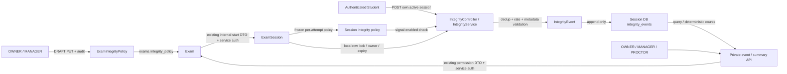

# GRAPHIFY DELTA — Exam Taking Phase 2 backend

Canonical graph owner: MAIN. Không rebuild graph từ worker.

Snapshot đã đọc: common Git `graphify/out/main/snapshot.json`, commit `6ab87d4`,
`dirty=true`, built_at `2026-10-05T04:19:32.043850+00:00`. Snapshot này cũ hơn
committed MAIN base `966cd35`; các quan hệ dưới đây được kiểm chứng bằng source
và PostgreSQL/HTTP tests, không suy từ graph cũ.

## Nodes và quan hệ bổ sung

Source nodes chính:

- `exam-service/.../dto/IntegrityPolicy.java`: monitor booleans, LOG_ONLY/WARN_ONLY.
- `Exam.integrityPolicy`, `ExamCore.integrityPolicy`, `ExamController` policy API,
  audit `INTEGRITY_POLICY_UPDATED`; existing Exam response có additive policy.
- `exam-session-service/.../dto/IntegrityPolicy.java`: consumer-owned value DTO.
- `ExamClient.ExamDto.integrityPolicy` → `SessionService.startExam` →
  `ExamSession.integrityPolicy`, đóng băng khi tạo attempt.
- `IntegrityDto`/`IntegrityEvent`/`IntegrityEventRepository`/
  `IntegrityService`/`IntegrityController`: ingestion, private queries, summary.
- Exam V4 policy migration; Session V3 local identity FK, retry uniqueness,
  indexes, append-only update trigger.

Không nối event tới grade/submit/status mutation. Không có webcam, browser capture,
risk engine, AI hoặc topic WebSocket mới. Polling private query là live-review
foundation; broker submission Phase 1 không đổi. Graphify AST chỉ mô tả cấu trúc:
SQL constraint/auth/business invariant phải đối chiếu source và tests.

MAIN refresh canonical graph sau review/merge, không report worker branch là đã
integrated. Contract frontend nằm tại `PHASE2_BROWSER_INTEGRITY.md` cùng thư mục.
